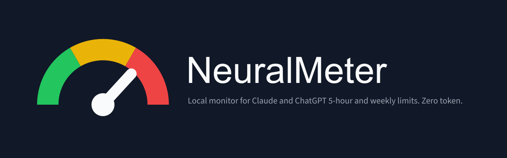
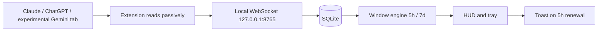
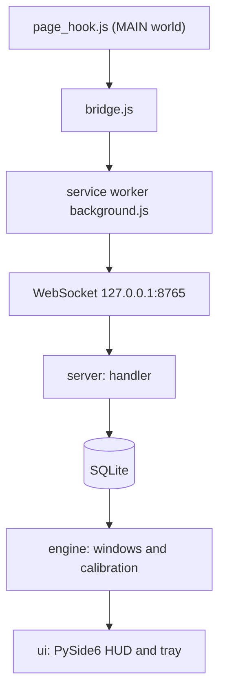
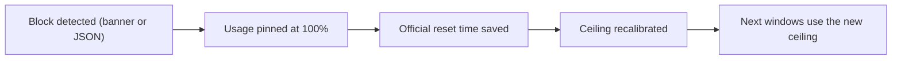

<p align="center">
  <a href="./README.md">Português</a> &nbsp;|&nbsp; <strong>English</strong>
</p>

<p align="center">
  
</p>

<p align="center">
  <strong>See your limits before you hit them.</strong><br />
  A local monitor for Claude and ChatGPT 5-hour and weekly limits that spends no tokens.
</p>

<p align="center">
  
  
  
  
  
  
  
</p>

<p align="center">
  <a href="https://github.com/dtdias/neural-meter/releases/latest"></a>
</p>

<p align="center">
  <a href="https://github.com/dtdias/neural-meter/releases/latest/download/NeuralMeter-Setup.exe">Download installer</a>
  &nbsp;·&nbsp;
  <a href="#quick-start">Quick start</a>
  &nbsp;·&nbsp;
  <a href="#architecture">Architecture</a>
  &nbsp;·&nbsp;
  <a href="#quotas-and-calculation">Quotas and calculation</a>
</p>

> NeuralMeter needs no login, account or cloud. Data stays 100% local, the app listens only on loopback (`127.0.0.1:8765`) and the text of your prompts is never stored.

## Why it exists

Claude and ChatGPT plans have 5-hour windows and weekly limits that only become visible once you are already blocked. NeuralMeter keeps an always-visible HUD on Windows showing how much of each window is already used, so you can plan your work before being interrupted.

The numbers are **estimates**, not a guarantee of the official limits. Providers do not publish the exact rules; the app computes from what the extension passively observes and recalibrates when the server reports the real reset or when a block happens.

Claude quota snapshots are experimental: route/schema lack validated browser capture. Account scope uses local HMAC; HUD requires exactly one confirmed Claude tab and unambiguous identity. Zero/multiple tabs, ambiguous identities or offline extension force estimated fallback. A switch without another quota response is not detectable. ChatGPT remains estimated; Codex quota is not treated as ChatGPT web quota.

Gemini Web is also integrated experimentally: HUD shows observed submissions and approximate tokens only. Gemini quota, percentage and reset remain unknown; this relies on a public community description of an internal format, not a Google contract, and needs browser validation.

## What it delivers

| Capture | Calculate | Show |
| --- | --- | --- |
| Passive Manifest V3 extension captures Claude, ChatGPT and experimental Gemini without sending prompts. | Existing estimated/official windows; Gemini shows counts without invented quota. | Always-on-top HUD, tray icon and Windows toast when 5-hour quota renews. |

### Flow



### Included capabilities

- Frameless, always-on-top HUD with snapping to screen edges.
- Expanded mode per provider (5-hour window and weekly usage) and compact mode (pill with 5-hour bar and `N% left`).
- Usage colors: green below 70%, yellow 70 to 89%, red at 90% or above, or when blocked.
- Opacity from 20 to 100% and click-through.
- System tray with show/hide, manual limits and start with Windows.
- Windows toast when the 5-hour quota renews.
- Private mode with hashed conversation IDs and configurable retention; clear history from the tray.
- Auto-calibration: when a real block is detected, it pins 100%, stores the reset time and adjusts the ceiling.
- ChatGPT tracked per model; Claude weighted by the conversation's accumulated context.
- 5h/7d windows persisted in SQLite: restarting the app does not reset them.

## Architecture



The extension (`extension/src`) injects `page_hook.js` into the page context, forwards captures through `bridge.js` to the service worker (`background.js`), which sends them over the WebSocket. In the app (`src/neuralmeter`), `server/` receives and validates messages, `db.py` persists to SQLite, `engine/` computes the windows (Claude, ChatGPT, weekly, weighting and calibration) and `ui/` renders the HUD, tray and notices in PySide6. `privacy.py` and `config.py` handle privacy and configuration.

## Quotas and calculation

- **Claude**: the 5-hour window starts at the first message and ends at the official reset when the server reports it. Each message is weighted by the conversation's accumulated context, since history is resent every turn.
- **ChatGPT**: each message expires individually, per model, with a default 3h window (5h configurable).
- **Weekly**: usage accumulated over a 7-day window.
- **Default ceilings**: 45 units for the 5-hour window and 500 for the weekly one; both editable from the tray.
- **ASSUMPTIONS (PREMISSAs)**: without a real capture (HAR), ceilings and per-model quotas are estimated values until real blocks calibrate the app.



## Stack

| Layer | Choice |
| --- | --- |
| Interface | PySide6 (frameless HUD, tray, toast) |
| Communication | `websockets` on loopback (`127.0.0.1:8765`) |
| Persistence | Native `sqlite3` in WAL mode |
| Extension | Plain JavaScript, Manifest V3, no build step |
| Packaging | PyInstaller onefile and Inno Setup 6 installer |
| Manager | `uv` with Python 3.13 |

## Quick start

### Installation (user)

1. Download and run `NeuralMeter-Setup.exe` from the [Release](https://github.com/dtdias/neural-meter/releases/latest). Setup is per-user, in `%LOCALAPPDATA%\Programs\NeuralMeter`, **no admin needed**. Optional tasks: desktop shortcut and start with Windows.
   - The installer is **not signed**: SmartScreen may warn ("Windows protected your PC"). Click **More info** and then **Run anyway**.
2. Install the **NeuralMeter Bridge** extension (Chrome, Edge, Brave or Opera):
   1. Download `NeuralMeter-Bridge-<version>.zip` from the Release and unzip it into a permanent folder.
   2. Open `chrome://extensions` (or `edge://extensions`) and turn on **Developer mode**.
   3. Click **Load unpacked** and select the unzipped folder.
3. Open NeuralMeter and use claude.ai / chatgpt.com as usual. Gemini Web shows experimental local counts; quota/reset remain unknown.

To uninstall: Windows Settings, Apps, NeuralMeter. Data in `%LOCALAPPDATA%\NeuralMeter` is kept; delete the folder to remove everything.

### Development

Python through [`uv`](https://docs.astral.sh/uv/) (3.13).

```powershell
uv sync                                  # dependencies
uv run neuralmeter                       # run the app
uv run neuralmeter --server-only         # WS server only, no UI (Ctrl+C to stop)
```

## Quality

```powershell
uv run pytest                                          # app tests
uv run ruff check .                                    # lint
uv run ruff format --check .                           # formatting
cd extension; npm test                                 # extension tests
uv run python scripts/perf_check.py                    # RNF01/RNF02 (port 8765 free, ~45 s)
uv run python scripts/build_exe.py --smoke             # dist/NeuralMeter.exe + smoke
uv run python scripts/build_installer.py [--skip-exe]  # installer + extension zip
```

Tests cover windows/calibration, DB/privacy, protocol/WS, HUD, and Claude/ChatGPT/Gemini capture (synthetic fixtures); Gemini capture has not been browser-validated. Installer requires Inno Setup 6 (`winget install --id JRSoftware.InnoSetup -e --scope user`); outputs go to `dist/`.

## Privacy and operation

- All data stays local, in SQLite inside your Windows profile.
- By default only character/token counts and metadata are stored; the prompt text is never written.
- The WebSocket listens only on `127.0.0.1` and accepts only `chrome-extension://` origins.
- No login, proxy or CAPTCHA bypass; no request to claude.ai/chatgpt.com is made outside the browser, and the extension never sends prompts.
- In private mode, conversation IDs are stored as hashes with a local salt.
- Clearing history is a tray action.

## Documentation

- [`prd.md`](prd.md): requirements and roadmap (Portuguese).
- [`progress.md`](progress.md): execution state and decisions (Portuguese).
- [`AGENTS.md`](AGENTS.md): operational rules and repository commands.
- [`extension/README.md`](extension/README.md): NeuralMeter Bridge extension.
- [`packaging/neuralmeter.iss`](packaging/neuralmeter.iss): Inno Setup installer script.
- [`scripts/build_installer.py`](scripts/build_installer.py): installer and extension zip generation.
- [`scripts/build_exe.py`](scripts/build_exe.py): PyInstaller executable build.
- [`scripts/perf_check.py`](scripts/perf_check.py): RAM, CPU and latency measurement.

## Scope notes

- Not an official Anthropic or OpenAI tool; values are estimates.
- Send and limit captures rely on **assumptions** (no real HAR) until validated.
- Latency from sending in the browser to the HUD was not measured; only the WebSocket-to-HUD leg and the app's resource usage.
- The installer and executable are not signed.
- Windows and Chromium browsers only; no Firefox and no MSI.

---

Built so you can see the limit before it shows up as a block.

Developed by **Daniel Trajano Dias** · [`@dtdias`](https://github.com/dtdias)
