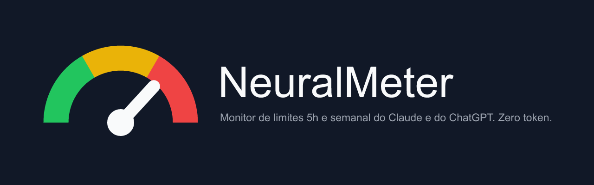

<p align="center"></p>

<p align="center">
  
  
  
</p>

<p align="center">
  <a href="https://github.com/dtdias/neural-meter/releases/latest"></a>
</p>

<p align="center">
  Download direto: <a href="https://github.com/dtdias/neural-meter/releases/latest/download/NeuralMeter-Setup.exe">https://github.com/dtdias/neural-meter/releases/latest/download/NeuralMeter-Setup.exe</a>
</p>

> **Nota para quem publica a Release:** o asset do instalador deve se chamar `NeuralMeter-Setup.exe` (nome estável, sem versão) para o link direto acima funcionar. O build gera `dist/NeuralMeter-Setup-<versão>.exe`; renomeie ao anexar na Release.

## O que é

Medidor local do uso e dos limites de **Claude** e **ChatGPT**: janela de 5 horas e uso semanal (7 dias), em um HUD sempre visível no Windows. **Zero token**: só leitura passiva via extensão de navegador, sem enviar prompts.

## Como funciona

Plataformas web usam proteções (Cloudflare, TLS fingerprint, cookies `HttpOnly`), então a coleta acontece dentro do navegador, por uma extensão que fala com o app desktop via WebSocket local (`ws://127.0.0.1:8765`, só loopback).

```
[ Aba Claude.ai / ChatGPT.com ]
              |  leitura passiva de headers/streams e GETs de sessão
              v
[ Extensão NeuralMeter Bridge (Manifest V3) ]
              |  WebSocket local: 127.0.0.1:8765
              v
[ App Desktop NeuralMeter (Windows) ] <--> [ Banco local SQLite ]
              |
              v
[ HUD flutuante (always-on-top) + bandeja do sistema ]
```

## Instalação

1. Baixe e rode `NeuralMeter-Setup.exe` (ou `NeuralMeter-Setup-<versão>.exe` se gerado localmente). Instala por usuário em `%LOCALAPPDATA%\Programs\NeuralMeter`, **sem admin**. Tarefas opcionais: atalho na área de trabalho e "Iniciar com o Windows".
   - O instalador **não é assinado digitalmente**: o SmartScreen pode avisar ("Windows protegeu seu PC"). Clique em **Mais informações** -> **Executar assim mesmo**.
2. Instale a extensão **NeuralMeter Bridge** (Chrome/Edge/Brave/Opera):
   1. Descompacte `NeuralMeter-Bridge-<versão>.zip` em uma pasta fixa (não apague depois).
   2. Abra `chrome://extensions` (ou `edge://extensions`) e ative **Modo do desenvolvedor**.
   3. **Carregar sem compactação** e selecione a pasta descompactada.
3. Abra o NeuralMeter e use claude.ai / chatgpt.com normalmente.

**Desinstalar:** Configurações do Windows -> Aplicativos -> NeuralMeter (ou `unins000.exe` na pasta de instalação). Seus dados em `%LOCALAPPDATA%\NeuralMeter` são mantidos; apague a pasta manualmente para remover tudo.

## Recursos

- **HUD** expandido por provedor, com janela 5h e uso semanal; **modo compacto** (pílula) com barra 5h e `restam N%`.
- **Cores**: verde < 70%, amarelo 70-89%, vermelho >= 90% ou bloqueado.
- **Bandeja** do sistema: mostrar/ocultar, opacidade (20-100%), click-through, aviso de renovação 5h, modo privado e apagar histórico.
- **Toast do Windows** ao renovar a cota de 5h.
- **Auto-calibração**: ao detectar bloqueio real, crava 100%, guarda o horário de reset e ajusta o teto.
- **Persistência** das janelas 5h/7d em SQLite (reiniciar não zera).

## Privacidade e zero token

- A extensão só lê passivamente; nunca envia prompts nem chama endpoint que dispare inferência.
- Nenhuma requisição a claude.ai/chatgpt.com é feita fora do navegador.
- WebSocket só em `127.0.0.1`; dados 100% locais.
- Por padrão guarda apenas contagem de caracteres/tokens e metadados, não o texto do prompt; há modo privado e opção de apagar o histórico.

## Desenvolvimento

Python via [`uv`](https://docs.astral.sh/uv/) (3.13).

```powershell
uv sync                                          # dependências
uv run neuralmeter                               # rodar o app
uv run neuralmeter --server-only                 # só servidor WS, sem UI
uv run pytest                                    # testes
uv run ruff check .                              # lint
uv run ruff format .                             # formatação
cd extension; npm test                           # testes da extensão
uv run python scripts/build_exe.py --smoke       # dist/NeuralMeter.exe
uv run python scripts/build_installer.py [--skip-exe]   # instalador + zip da extensão
```

O instalador exige Inno Setup 6 (`winget install --id JRSoftware.InnoSetup -e --scope user`); saídas em `dist/`. O banner `assets/hero.png` é derivado de `assets/hero.svg`.

## Limitações conhecidas

- As capturas de envio/limite de Claude e ChatGPT seguem **premissas** (sem HAR real); os tetos e cotas por modelo são estimativas até calibrarem com bloqueios reais.
- A latência do envio no navegador até o HUD não foi medida; só o trecho WebSocket -> HUD (medido localmente) e o uso de recursos do app.
- Instalador e executável não são assinados.

## Licença

[MIT](LICENSE)
