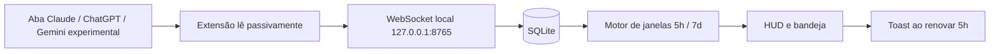
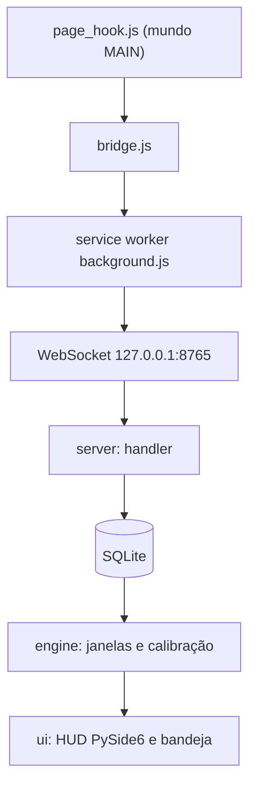
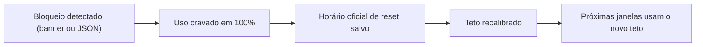

<p align="center">
  <strong>Português</strong> &nbsp;|&nbsp; <a href="./README.en.md">English</a>
</p>

<p align="center">
  
</p>

<p align="center">
  <strong>Veja seus limites antes de bater neles.</strong><br />
  Monitor local de limites de 5h e semanais do Claude e do ChatGPT, sem gastar nenhum token.
</p>

<p align="center">
  
  
  
  
  
  
  
</p>

<p align="center">
  <a href="https://github.com/dtdias/neural-meter/releases/latest"></a>
</p>

<p align="center">
  <a href="https://github.com/dtdias/neural-meter/releases/latest/download/NeuralMeter-Setup.exe">Baixar instalador</a>
  &nbsp;·&nbsp;
  <a href="#início-rápido">Início rápido</a>
  &nbsp;·&nbsp;
  <a href="#arquitetura">Arquitetura</a>
  &nbsp;·&nbsp;
  <a href="#cotas-e-cálculo">Cotas e cálculo</a>
</p>

> O NeuralMeter não exige login, conta nem nuvem. Os dados ficam 100% locais, o app escuta apenas em loopback (`127.0.0.1:8765`) e o texto dos seus prompts nunca é gravado.

## Por que existe

Planos de Claude e ChatGPT têm janelas de 5 horas e limites semanais que só ficam visíveis quando o bloqueio já aconteceu. O NeuralMeter mantém um HUD sempre visível no Windows mostrando quanto da janela já foi consumido, para você planejar o trabalho antes de ser interrompido.

Os números são **estimativas**, não uma garantia dos limites oficiais. Os provedores não publicam as regras exatas; o app calcula a partir do que a extensão observa passivamente e se recalibra quando o servidor informa o reset real ou quando um bloqueio acontece.

Snapshot Claude oficial é experimental: rota/esquema sem captura validada. Escopo conta usa HMAC local; HUD exige uma aba confirmada e identidade sem ambiguidade. Múltiplas abas/identidades ou extensão offline causam fallback estimado. Troca sem resposta de cota não é detectável. ChatGPT segue estimativa; sem inferir cota web via Codex.

Gemini Web também está integrado experimentalmente: HUD mostra somente envios observados e tokens aproximados. Quota, percentual e reset Gemini permanecem desconhecidos; integração baseada em formato interno público não é contrato Google e requer validação em navegador.

## O que entrega

| Capturar | Calcular | Mostrar |
| --- | --- | --- |
| Extensão passiva (Manifest V3) captura Claude, ChatGPT e Gemini experimental, sem enviar prompts. | Janelas estimadas/oficiais existentes; Gemini exibe contagens sem quota inventada. | HUD always-on-top, ícone na bandeja e toast do Windows ao renovar a cota de 5h. |

### Fluxo



### Capacidades incluídas

- HUD sem moldura, sempre no topo, com encaixe (snap) nas bordas da tela.
- Modo expandido por provedor (janela 5h e uso semanal) e modo compacto (pílula com barra 5h e `restam N%`).
- Cores por uso: verde abaixo de 70%, amarelo de 70 a 89%, vermelho a partir de 90% ou bloqueado.
- Opacidade de 20 a 100% e click-through.
- Bandeja do sistema com mostrar/ocultar, limites manuais e iniciar com o Windows.
- Toast do Windows ao renovar a cota de 5h.
- Modo privado com hash dos IDs de conversa e retenção configurável; apagar histórico pela bandeja.
- Auto-calibração: ao detectar bloqueio real, crava 100%, guarda o horário de reset e ajusta o teto.
- ChatGPT contabilizado por modelo; Claude ponderado pelo contexto acumulado da conversa.
- Janelas 5h/7d persistidas em SQLite: reiniciar o app não zera.

## Arquitetura



A extensão (`extension/src`) injeta `page_hook.js` no contexto da página, repassa as capturas pelo `bridge.js` ao service worker (`background.js`) e este as envia pelo WebSocket. No app (`src/neuralmeter`), `server/` recebe e valida as mensagens, `db.py` persiste em SQLite, `engine/` calcula as janelas (Claude, ChatGPT, semanal, peso e calibração) e `ui/` renderiza o HUD, a bandeja e os avisos em PySide6. `privacy.py` e `config.py` cuidam de privacidade e configuração.

## Cotas e cálculo

- **Claude**: a janela de 5h começa na primeira mensagem e termina no reset oficial quando o servidor o informa. Cada mensagem pesa conforme o contexto acumulado da conversa, já que o histórico é reenviado a cada turno.
- **ChatGPT**: cada mensagem expira individualmente, por modelo, com janela padrão de 3h (5h configurável).
- **Semanal**: uso acumulado em uma janela de 7 dias.
- **Tetos padrão**: 45 unidades na janela de 5h e 500 na semanal; ambos editáveis pela bandeja.
- **PREMISSAs**: sem captura (HAR) real, os tetos e as cotas por modelo são valores estimados até que bloqueios reais calibrem o app.



## Stack

| Camada | Escolha |
| --- | --- |
| Interface | PySide6 (HUD frameless, bandeja, toast) |
| Comunicação | `websockets` em loopback (`127.0.0.1:8765`) |
| Persistência | `sqlite3` nativo em modo WAL |
| Extensão | JavaScript puro, Manifest V3, sem build |
| Empacotamento | PyInstaller onefile e instalador Inno Setup 6 |
| Gerenciador | `uv` com Python 3.13 |

## Início rápido

### Instalação (usuário)

1. Baixe e rode `NeuralMeter-Setup.exe` da [Release](https://github.com/dtdias/neural-meter/releases/latest). O setup é por usuário, em `%LOCALAPPDATA%\Programs\NeuralMeter`, **sem admin**. Tarefas opcionais: atalho na área de trabalho e iniciar com o Windows.
   - O instalador **não é assinado**: o SmartScreen pode avisar ("Windows protegeu seu PC"). Clique em **Mais informações** e depois **Executar assim mesmo**.
2. Instale a extensão **NeuralMeter Bridge** (Chrome, Edge, Brave ou Opera):
   1. Baixe `NeuralMeter-Bridge-<versão>.zip` da Release e descompacte em uma pasta fixa.
   2. Abra `chrome://extensions` (ou `edge://extensions`) e ative o **Modo do desenvolvedor**.
   3. Clique em **Carregar sem compactação** e selecione a pasta descompactada.
3. Abra NeuralMeter e use claude.ai / chatgpt.com normalmente. Gemini Web mostra contagens locais experimentais; quotas/reset permanecem desconhecidos.

Para desinstalar: Configurações do Windows, Aplicativos, NeuralMeter. Os dados em `%LOCALAPPDATA%\NeuralMeter` são mantidos; apague a pasta para remover tudo.

### Desenvolvimento

Python via [`uv`](https://docs.astral.sh/uv/) (3.13).

```powershell
uv sync                                  # dependências
uv run neuralmeter                       # rodar o app
uv run neuralmeter --server-only         # só servidor WS, sem UI (Ctrl+C para parar)
```

## Qualidade

```powershell
uv run pytest                                          # testes do app
uv run ruff check .                                    # lint
uv run ruff format --check .                           # formatação
cd extension; npm test                                 # testes da extensão
uv run python scripts/perf_check.py                    # RNF01/RNF02 (porta 8765 livre, ~45 s)
uv run python scripts/build_exe.py --smoke             # dist/NeuralMeter.exe + smoke
uv run python scripts/build_installer.py [--skip-exe]  # instalador + zip da extensão
```

Os testes cobrem motor de janelas/calibração, DB/privacidade, protocolo/WS, HUD e capturas Claude/ChatGPT/Gemini (fixtures sintéticas); captura Gemini não validada em navegador real. O instalador exige Inno Setup 6 (`winget install --id JRSoftware.InnoSetup -e --scope user`); saídas em `dist/`.

## Privacidade e operação

- Todos os dados ficam locais, em SQLite no seu perfil do Windows.
- Por padrão guarda só contagem de caracteres/tokens e metadados; o texto do prompt nunca é gravado.
- O WebSocket escuta somente em `127.0.0.1` e aceita apenas `Origin` de `chrome-extension://`.
- Sem login, proxy ou bypass de CAPTCHA; nenhuma requisição a claude.ai/chatgpt.com é feita fora do navegador, e a extensão nunca envia prompts.
- No modo privado, os IDs de conversa são gravados como hash com salt local.
- Apagar o histórico é uma ação da bandeja.

## Documentação

- [`prd.md`](prd.md): requisitos e roadmap.
- [`progress.md`](progress.md): estado de execução e decisões.
- [`AGENTS.md`](AGENTS.md): regras operacionais e comandos do repositório.
- [`extension/README.md`](extension/README.md): extensão NeuralMeter Bridge.
- [`packaging/neuralmeter.iss`](packaging/neuralmeter.iss): script do instalador Inno Setup.
- [`scripts/build_installer.py`](scripts/build_installer.py): geração do instalador e do zip da extensão.
- [`scripts/build_exe.py`](scripts/build_exe.py): build do executável PyInstaller.
- [`scripts/perf_check.py`](scripts/perf_check.py): medição de RAM, CPU e latência.

## Notas de escopo

- Não é uma ferramenta oficial da Anthropic nem da OpenAI; os valores são estimativas.
- As capturas de envio e de limite seguem **premissas** (sem HAR real) até serem validadas.
- A latência do envio no navegador até o HUD não foi medida; só o trecho WebSocket para HUD e o uso de recursos do app.
- Instalador e executável não são assinados.
- Somente Windows e navegadores Chromium; sem Firefox e sem MSI.

---

Feito para você enxergar o limite antes de ele aparecer como bloqueio.

Desenvolvido por **Daniel Trajano Dias** · [`@dtdias`](https://github.com/dtdias)
